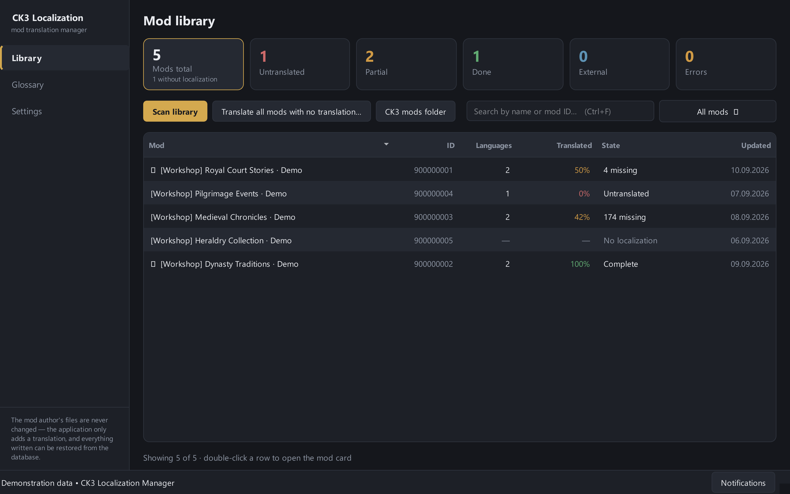
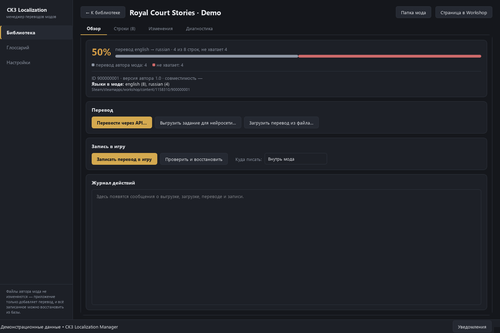
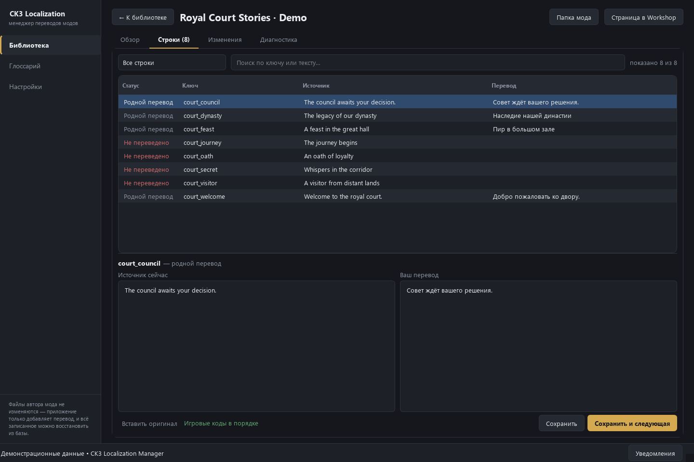
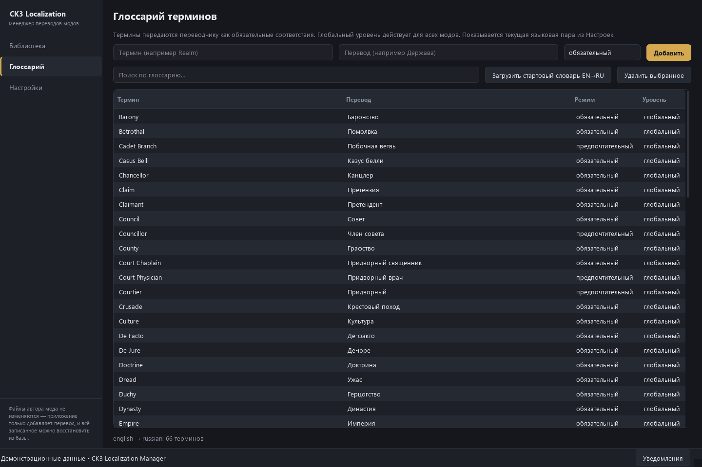
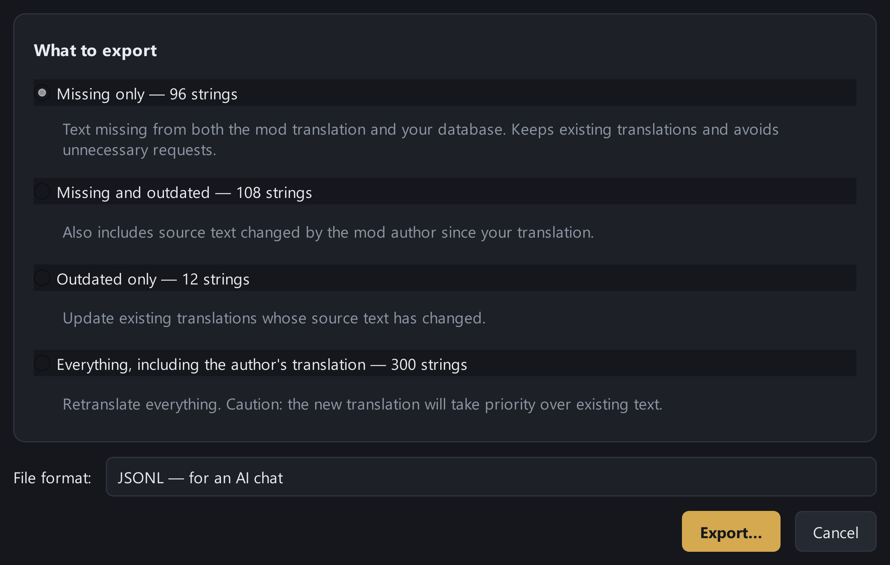

# CK3 Localization Manager

**Языки интерфейса: английский, русский, немецкий, французский, испанский, упрощённый китайский и корейский.**
### Больше историй на вашем языке.
Переводите моды Crusader Kings III, следите за изменениями и сохраняйте свою работу после обновлений.

[**Скачать приложение**](https://github.com/rqkeqq-ui/ck3translate/releases) · [Как пользоваться](USER_GUIDE.ru.md) · [Сообщить об ошибке](https://github.com/rqkeqq-ui/ck3translate/issues) · [English](../README.md)

## Любимый мод обновился. Перевод тоже должен успевать.

CK3 Localization Manager собирает работу с локализациями в одном окне: показывает, где не хватает перевода, помогает перевести нужные строки и восстановить созданные приложением файлы. Для игроков, которые хотят понимать каждое событие, и переводчиков, которым важно не начинать заново после каждого обновления.

### Вся библиотека перед глазами

Сканируйте установленные подписки Steam Workshop. Находите моды без перевода, неполные локализации и отдельные русификаторы. Процент показывает наличие строк по ключам — качество текста всё равно стоит проверить.

### Переводите так, как удобно вам

Выгрузите задание с промптом в JSONL, отправьте его в ChatGPT, Claude, DeepSeek или другой чат и импортируйте результат. Для этого не нужен API-ключ; доступность бесплатного чата зависит от выбранного сервиса. Или переводите прямо в программе. «Google Translate · бесплатно» работает без ключа: это неофициальный публичный шлюз, у него есть ограничения частоты. Google Cloud, DeepL, Yandex, Claude и OpenAI-совместимые API работают с вашим ключом. Локальный ИИ-сервер (LM Studio, llama.cpp, Ollama) подключается по адресу, ключ не нужен. Подписку ChatGPT можно использовать через Sign in with ChatGPT (предварительно, нужен платный план). У провайдеров свои тарифы и лимиты. Для переводческих программ есть XLIFF.

### Работа остаётся с вами

Приложение добавляет собственные файлы перевода, сохраняя исходные файлы автора. Можно писать внутрь каталога мода или создать отдельный патч-мод. История, резервные копии и проверка изменений помогают восстановить записанный приложением перевод после обновления Steam. Новые и изменённые автором строки можно переводить отдельно.

### Термины и игровой синтаксис под контролем

Редактор показывает исходник и перевод рядом. Глоссарий и память переводов помогают сохранять единый стиль; справочник vanilla можно получить из установленной CK3. Проверка токенов обнаруживает потерянные переменные, теги и команды до записи. Автоматическая проверка не заменяет вычитку и проверку в игре.

## Посмотрите, как это работает

| Карточка мода | Редактор строк |
| --- | --- |
|  |  |
| **Глоссарий** | **Экспорт для чата** |
|  |  |

Скриншоты настоящего интерфейса с вымышленными демонстрационными модами. [Скачать исходные PNG галереи](images).

## Начните за несколько минут

1. Откройте [Releases](https://github.com/rqkeqq-ui/ck3translate/releases) и скачайте архив для своей системы.
2. Распакуйте **весь архив**. На Windows запустите `CK3LocalizationManager.exe`, на Linux — `CK3LocalizationManager`, на macOS — приложение `.app`. Python устанавливать не нужно.
3. Выберите языки и просканируйте библиотеку. Если Steam не найден, укажите его папку в настройках.
4. Откройте мод, переведите недостающие строки, проверьте результат и запишите перевод.

Windows x64, Linux x64 и macOS Apple Silicon собираются отдельно. Доступные файлы и ограничения конкретной версии перечислены в релизе. [Подробное руководство](USER_GUIDE.ru.md).

## Community Database — база, которая растёт вместе с сообществом

Необязательная база для связей модов с русификаторами, общих терминов и правил обработки. Общие термины распространяются через подписку Workshop отдельно от приложения; реестр связей и правила пока пусты. Присылайте проверяемые предложения через Issues.

**[Подписаться на Community Database в Steam Workshop](https://steamcommunity.com/sharedfiles/filedetails/?id=3799038632).** Дождитесь загрузки файлов Steam и откройте приложение. Если база не найдена, окно при запуске предложит открыть Workshop, проверить загрузку или продолжить без базы. Подписка необязательна.

Подписка скачивает только данные, а не приложение. **Базу не нужно включать в playset.**

## Открытый проект

Бесплатное приложение с открытым исходным кодом под [GNU GPL v3](../LICENSE) (с версии 0.3.0; прежние версии выходили под MIT). Его можно использовать, изучать, менять и распространять; распространяемые изменённые версии должны оставаться под GPL с исходным кодом. Сервисы перевода оплачиваются отдельно, если требуют оплаты. Проект не связан с Paradox Interactive или Valve. Лицензии сторонних компонентов приведены [отдельно](THIRD_PARTY_NOTICES.md).

[Поддержать разработку](SUPPORT.md) · [Руководство пользователя](USER_GUIDE.ru.md)

## Новое в 0.2.0

Локальные моды теперь видны рядом с Workshop. Папку можно выбрать вручную в Настройках; локальные моды работают и без Steam. При запуске программа предлагает новые версии с возможностью отложить или пропустить конкретную версию; обновление скачивается с GitHub вручную.

## Новое в 0.3.0

Перевод теперь проходит через черновик: выгрузка, импорт и перевод не меняют мод, пока вы не нажмёте **Применить выбранное** и **Записать перевод в игру**. Можно выделить и исправить отдельные строки даже при 100%, разбить большое задание для нейросети на части и загрузить все ответы сразу, отменить применённый перевод в «Истории действий» и выборочно убрать непроверенные переводы Google/DeepL/Яндекса. Источник перевода (LLM, сервис, ручной, автор мода…) хранится отдельно от проверки. Подробности — в [руководстве](USER_GUIDE.ru.md).
